# FunL

Learning through games for school-age kids. It's a web app that works with **touch, keyboard and game controllers**, and it records detailed play data (speed, accuracy, misclicks) for later analysis.

**Math Monster** has two modes:
- **Adventure:** the moon-fox brothers Nyx and Myx have been corrupted by the Static. Your swordswoman answers the equations they throw at her, and round by round the spirit turns from menacing to cute. In the boss round you break the last shard by **forging seals**: puzzles where you put numbers, signs and brackets in the right order (order of operations) to make an exact number. Then befriend the spirit as your companion.
- **Practice classroom:** you and your companion sit side by side, each with your own column of equations on the chalkboard. You both answer at your own pace. Your companion thinks out loud: its thought bubble shows real mental-math strategies step by step (count on, make ten, tens and ones…). When it's wrong, you can see where its reasoning slipped. It earns maths stars as you practise together. Pass a stage (9/12) and the next, harder one starts automatically; otherwise try again. The **Forge workshop** is practice for the order of operations, with its own ladder of 6 levels to unlock. You can practise alone, or with your companion, who shows its tries (and its left-to-right mistakes) in its bubble.

The Math Monster screen opens on two big choices, **⚔️ Adventure** (a world map that shows where you are) and **📚 Practice** (Classroom and Forge workshop blocks). The Journal, Progress, Worksheets and Controls live in a small settings bar at the top.

**Maze Duel** is a race against **Glitch**, a cheeky Static imp, through a mirrored number maze. Every right answer builds one square of your path. Operator squares (+3, −2, ×2, ÷2) change the number your path carries, and only exactly the ★ gate's number opens it. Drop stones to block Glitch, step back out of dead ends, and watch Glitch think (and slip) in its thought bubble.

## Current build

**v0.15.0 · "World Map"** (2026-11-02). Full history in [PATCHNOTES.md](PATCHNOTES.md).

| | |
|---|---|
| **Games** | **Math Monster** and **Maze Duel** |
| **Playable** | Math Monster: Adventure on a world map (World 1 · Nyx, World 2 · Myx, then Endless; nodes open as you clear them; boss rounds = forge puzzles on the order of operations, with a countdown in the equation bar; 10 stages + endless, 5-round spirit encounters with boss rounds, 5 lives refilled every round, up to 4 equations at once with knockback on correct answers), Practice with two blocks: the classroom (a map of 18 stages, 9 topics × 2 paces) and the Forge workshop (a map of 6 levels to unlock, alone or with the companion), Spirit Journal, worksheet import. Maze Duel: 4 topics, rival at 3 difficulties, path hints, record per player. Data export and diagnostics |
| **Characters** | Hero: anime swordswoman. Spirits: Nyx (little brother) and Myx (big brother), 5 forms each. Rival: Glitch, the Static imp |
| **Input** | Touch/mouse on-screen keypad · keyboard · **Xbox-style controller with a radial number dial** (left stick points, A types, X deletes, Y sends). Every menu works with only a controller (on-screen keyboard for names) |
| **Pacing** | Learns each player's input speed per device and answer length (measured from the first stick movement, key or tap) and gives every equation matching extra time |
| **Sound** | Synthesised effects (13 moments × 3–4 moods) and 6 generative music loops for Menus / Adventure / Boss / Classroom / Maze duel, chosen in the 🔊 Sound panel (menu and pause) |
| **Thinking characters** | 30 mental-math strategies with typical slips, used by the companion (maths mastery 0–5 ★) and by Glitch (skill per difficulty); order-of-operations reasoning for forge puzzles |
| **Progress** | Saved per player in the browser (world map, spirits, companion, classroom stages, Forge levels); resettable from the Math Monster screen ("Reset progress"). Maze Duel keeps a win/loss record |
| **Tests** | 118 unit/property tests in 17 files (`npm test`), all passing |
| **Bundle** (production) | JS 549 kB (170 kB gzipped) · CSS 68 kB (15 kB gzipped) |
| **Runs on** | Current Chromium-based browsers (Edge, Chrome), tested on desktop, tablet and phone sizes in portrait and landscape |

## Quick start

```bash
npm install
npm run dev          # http://localhost:5173   (?log=debug verbose logs, ?gallery character art)
npm test             # unit tests
npm run typecheck && npm run lint
npm run build        # production build → dist/
npm run diagrams     # draw every diagram in docs/ as an image (docs/diagrams/) + refresh docs/DIAGRAMS.md and the README
```

Requires Node 22+.

## Tools and technologies

Versions are the ones installed for the current build (ranges are in `package.json`, exact versions in `package-lock.json`).

### Language and runtime
| Tool | Version | What it is | How we use it |
|---|---|---|---|
| **TypeScript** | 6.0.3 | JavaScript with static types | All app and test code. Strict settings (`noUnusedLocals`, `erasableSyntaxOnly`, `verbatimModuleSyntax`) in `tsconfig.app.json` |
| **Node.js** + **npm** | 22.12 / 10.9 | JavaScript runtime and package manager | Runs the dev server, build, tests and lint |

### App framework and build
| Tool | Version | What it is | How we use it |
|---|---|---|---|
| **React** (+ react-dom) | 19.3.1 | UI component library | All screens and game views. Games re-render every animation frame from a pure engine's state. `StrictMode` is on in dev |
| **Vite** + `@vitejs/plugin-react` | 8.3.4 / 6.1.2 | Dev server and bundler | Instant reload in dev and an optimised build in `dist/`. Also injects `__APP_VERSION__` from `package.json` (`vite.config.ts`) |

### Libraries
| Tool | Version | What it is | How we use it |
|---|---|---|---|
| **idb** | 8.0.4 | Small promise wrapper around IndexedDB | Talks to the browser database (`src/core/telemetry/storage.ts`) |
| **zod** | 4.6.7 | Schema validation | Validates content packs (e.g. worksheets) before they reach a game (`src/core/math/schema.ts`) |

### Browser platform APIs (no extra libraries)
| API | How we use it |
|---|---|
| **IndexedDB** | Profiles, sessions, telemetry events, content packs, per-player progress and diagnostics logs. Versioned step-by-step migrations (schema v3) |
| **localStorage** | Small per-device conveniences: last profile, per-player settings, log level |
| **Gamepad API** | Controller support: buttons and the analogue left stick (radial dial angle), polled every animation frame (`src/core/input/InputManager.ts`) |
| **Pointer Events** | Touch, mouse and pen input, plus misclick detection (taps that hit nothing) |
| **Keyboard Events** | Keyboard play and menu navigation |
| **requestAnimationFrame** | Game loops and gamepad polling |
| **Web Animations API** | Smooth piece movement in forge puzzles (FLIP: pieces glide from their old place to the new one, `src/core/ui/useFlip.ts`) |
| **Web Audio API** | All sound and music, synthesised live (oscillators, filtered noise, envelopes) with a look-ahead music scheduler (`src/core/audio`). No audio files |
| **SVG + CSS animations** | All art is code: the heroine, procedurally drawn spirits (`Creature.tsx`), Glitch and the maze. No image files |
| **Google Fonts** | The *Chakra Petch* typeface (loaded in `index.html`) |

### Testing and quality
| Tool | Version | What it is | How we use it |
|---|---|---|---|
| **Vitest** | 5.0.5 | Test runner (Vite-native, Jest-compatible) | Unit and property tests: game engines (Math Monster, Maze Duel incl. board fairness and an AI-against-AI completion test), problem generation, mental-math strategies, companion skill model, classroom stages, radial dial, telemetry, logging, storage migrations |
| **fake-indexeddb** | 6.2.6 | In-memory IndexedDB for Node | Lets storage and migration tests run outside a browser |
| **oxlint** | 1.88.0 | Fast linter (Rust) | Code quality, plus React rules (`.oxlintrc.json`, `npm run lint`) |
| **tsc** | 6.0.3 | TypeScript compiler | Type-checking (`npm run typecheck`). Vite does the actual compiling |
| **Playwright (`playwright-core`)** + Microsoft Edge | 1.56.1 (dev) | Browser automation | `npm run diagrams` uses it to draw the diagrams in headless Edge (or Chrome); it drives the installed browser and downloads none. Also used *ad hoc* to play through flows in a real headless browser (keyboard, touch, simulated Xbox controller incl. the analogue stick) and take screenshots. In dev builds, tests can inspect `window.__funl.engine` / `window.__funl.duel` and `window.__funlInput` |

### Project infrastructure and docs
| Tool | What it is | How we use it |
|---|---|---|
| **Git** + `.gitattributes` | Version control | LF line endings are enforced, and play-data exports and secrets are git-ignored |
| **Markdown + Mermaid** (11.17.2, dev) | Text docs and text-based diagrams | Architecture/UML diagrams are written as Mermaid text in `docs/`. `npm run diagrams` (`scripts/diagrams.mjs`) draws each one as an SVG image in `docs/diagrams/` and collects them in `docs/DIAGRAMS.md` and the README, so any Markdown preview shows them, no extension needed |
| **VS Code** | Editor | Recommended extensions in `.vscode/extensions.json`: Mermaid preview (optional: draws the Mermaid blocks inside the source docs), oxc (lint), Vitest explorer |
| **AI coding agents** | e.g. Claude Code | Work from `AGENTS.md` / `CLAUDE.md`. Every change is recorded in `PATCHNOTES.md` |

### In-house building blocks (in `src/core/`)
| Part | Purpose |
|---|---|
| Input system | Turns keyboard, gamepad (buttons + analogue stick) and touch into the same *actions*, with a control scheme per game |
| Telemetry | Records every play session's events for analysis |
| Logger | App diagnostics with levels, namespaces, persistence and error capture |
| Module registry | The contract every learning game implements, plus per-player settings and progress (save / reset) |
| Input pace | Learns how long each player needs to *enter* an answer per device and length, and gives equations matching extra time (`src/core/pace`, see [docs/INPUT-PACE.md](docs/INPUT-PACE.md)) |
| Audio engine | Sound effects per game moment and generative music per mood, with a library to audition and choose from (`src/core/audio`, see [docs/AUDIO.md](docs/AUDIO.md)) |
| Math kit | Problems, level rules, content-pack schemas, seeded RNG and problem difficulty, shared by every maths game (`src/core/math`) |
| Forge kit | Order-of-operations puzzles any game can use: expression parser/evaluator with steps and reasons, puzzle generator with levels and "traps", board state, the board view and controls (`src/core/math/expression.ts`, `forge.ts`, `src/core/ui/forge`, see [docs/FORGE.md](docs/FORGE.md)) |
| Game UI kit | Number entry (keypad, controller radial dial, answer dock), pause menu, the heroine, thought bubble, shared game styles (`src/core/ui`) |
| Mental-math engine | How people actually calculate: 30 strategies (count on, make ten, tens and ones, columns…) that turn a problem into reasoning steps and notes, plus the typical slips that lead to wrong answers (`src/core/mental-math`, see [docs/MENTAL-MATH.md](docs/MENTAL-MATH.md)) |

## How it fits together

The docs describe the game with diagrams (UML and flows). Here is the big picture. Every diagram is on one page in **[docs/DIAGRAMS.md](docs/DIAGRAMS.md)** ("open image" under each one shows it full size). They are drawn from the Mermaid text in `docs/` by `npm run diagrams`.

<!-- diagrams:start (generated by `npm run diagrams`, do not edit by hand) -->
### The game at a glance



**All diagrams** (drawn together in [docs/DIAGRAMS.md](docs/DIAGRAMS.md)):

- **Architecture**
  - [The game at a glance](docs/DIAGRAMS.md#0-the-game-at-a-glance) · Flow
  - [Component overview](docs/DIAGRAMS.md#1-component-overview) · Flow
  - [Core contracts (class diagram)](docs/DIAGRAMS.md#2-core-contracts-class-diagram) · Class (UML)
  - [Runtime flow: one answer (sequence diagram)](docs/DIAGRAMS.md#3-runtime-flow-one-answer-sequence-diagram) · Sequence (UML)
  - [App navigation (state diagram)](docs/DIAGRAMS.md#4-app-navigation-state-diagram) · State (UML)
  - [Engine phases (Math Monster)](docs/DIAGRAMS.md#5-engine-phases-math-monster) · State (UML)
  - [Storage: IndexedDB (ER diagram)](docs/DIAGRAMS.md#6-storage-indexeddb-er-diagram) · Data (ER)
- **Forge puzzles (order of operations)**
  - [The board (pure state)](docs/DIAGRAMS.md#the-board-pure-state) · State (UML)
- **Mental math: how people actually calculate**
  - [Model](docs/DIAGRAMS.md#model) · Class (UML)
- **Module: Math Monster (math-monster)**
  - [Internal structure](docs/DIAGRAMS.md#internal-structure) · Class (UML)
  - [Encounters, forms and spirits](docs/DIAGRAMS.md#encounters-forms-and-spirits) · State (UML)
  - [Practice mode (classroom)](docs/DIAGRAMS.md#practice-mode-classroom) · State (UML)
- **Module: Maze Duel (maze-duel)**
  - [Engine stages](docs/DIAGRAMS.md#engine-stages) · State (UML)
<!-- diagrams:end -->

## Documentation

| Doc | For |
|---|---|
| [AGENTS.md](AGENTS.md) | **Start here.** Repo map, rules, commands, how to keep docs current (people and AI agents) |
| [docs/DIAGRAMS.md](docs/DIAGRAMS.md) | Every diagram in the docs on one page as images, with a contents list (generated by `npm run diagrams`) |
| [docs/ARCHITECTURE.md](docs/ARCHITECTURE.md) | UML/Mermaid diagrams: components, contracts, runtime sequence, navigation, storage ER |
| [docs/TELEMETRY.md](docs/TELEMETRY.md) | Data dictionary of every recorded event and summary field |
| [docs/LOGGING.md](docs/LOGGING.md) | Diagnostics logging: levels, namespaces, getting logs from a device |
| [docs/MENTAL-MATH.md](docs/MENTAL-MATH.md) | How the app models mental calculation: strategies, reasoning steps, notes, slips |
| [docs/AUDIO.md](docs/AUDIO.md) | Sound effects and music: slots, moods, how to add a sound |
| [docs/FORGE.md](docs/FORGE.md) | Forge puzzles: rules, levels and traps, the board, controls, how thinkers solve them |
| [docs/INPUT-PACE.md](docs/INPUT-PACE.md) | How input time is measured and how equations get extra time for each player's pace |
| [docs/modules/math-monster.md](docs/modules/math-monster.md) | Math Monster: modes, rules, the classroom and companion model, controls, packs |
| [docs/modules/maze-duel.md](docs/modules/maze-duel.md) | Maze Duel: rules, board generation, Glitch's maths and planning, controls |
| [docs/lore/WORLD.md](docs/lore/WORLD.md) | The world of Lumora, the spirits, writing rules |
| [docs/DECISIONS.md](docs/DECISIONS.md) | Why things are the way they are |
| [PATCHNOTES.md](PATCHNOTES.md) | What changed in each version (game-style patch notes) |
