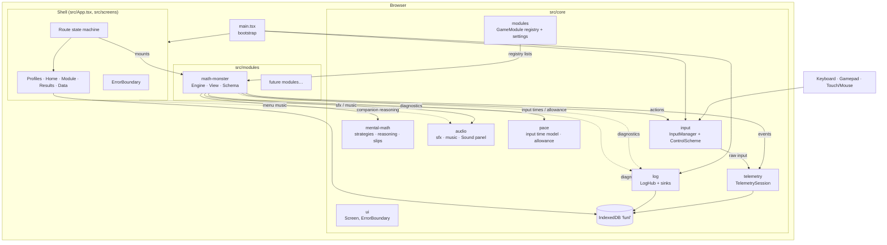
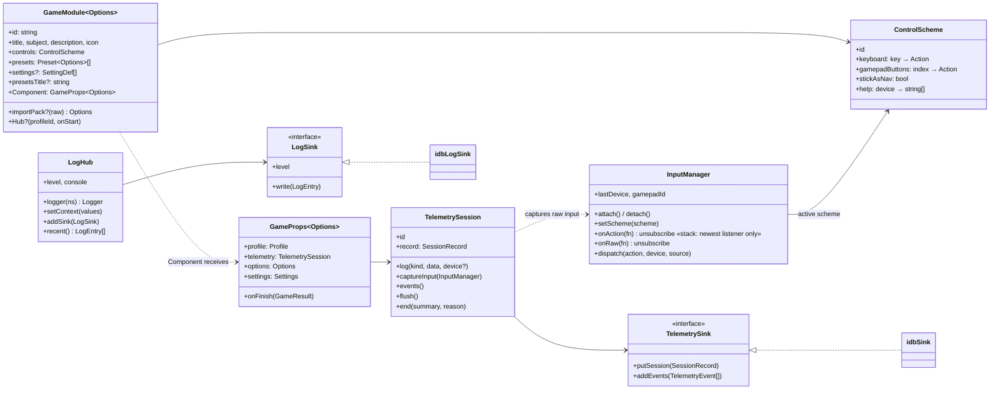
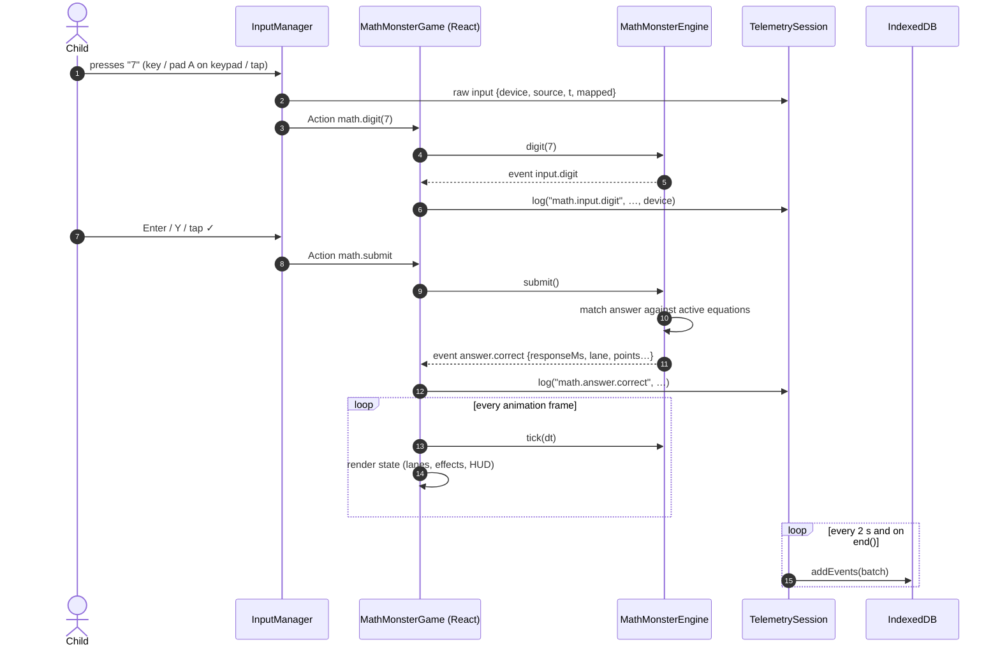
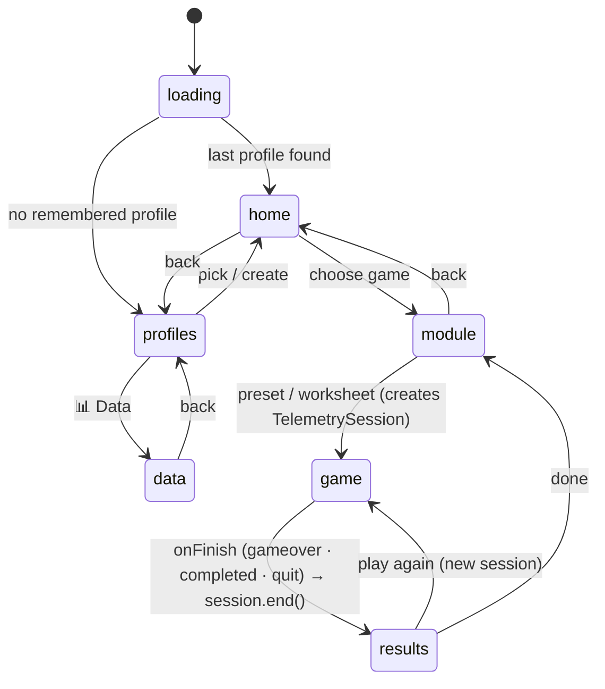
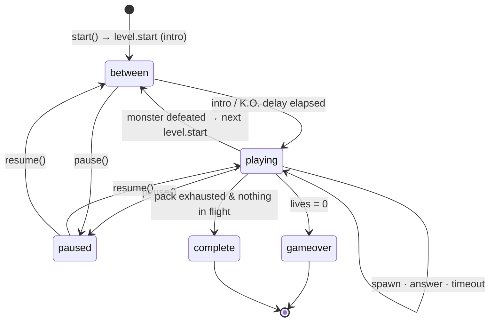
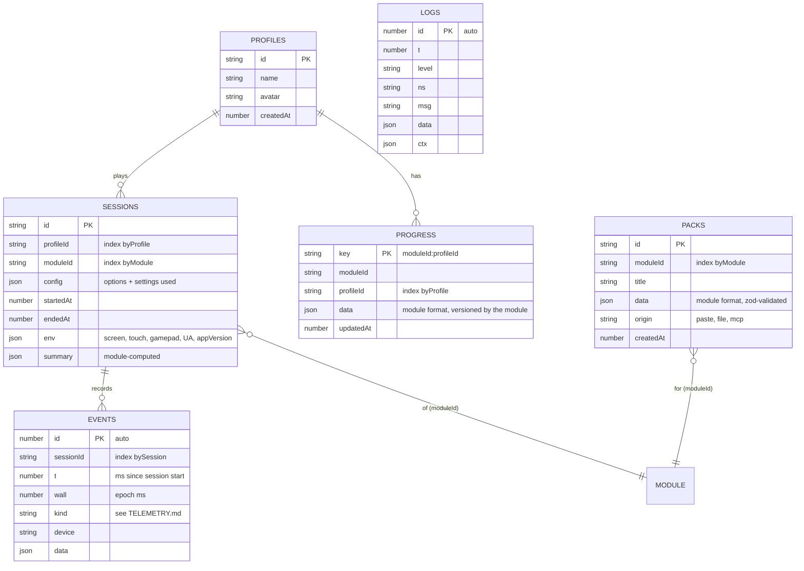

# Architecture

FunL is a client-only React + TypeScript single-page app built with Vite. All data lives in the browser's IndexedDB. A backend and an MCP server are planned; see the [last section](#mcp-and-backend-planned).

Contents: [Components](#1-component-overview) · [Core contracts (class diagram)](#2-core-contracts-class-diagram) · [Runtime flow (sequence)](#3-runtime-flow-one-answer-sequence-diagram) · [Navigation (state)](#4-app-navigation-state-diagram) · [Engine phases (state)](#5-engine-phases-math-monster) · [Storage (ER)](#6-storage-indexeddb-er-diagram) · [Input](#7-input-system) · [Telemetry vs logs](#8-telemetry-vs-logs) · [Adding a module](#adding-a-module) · [MCP plan](#mcp-and-backend-planned)

## 1. Component overview

**Dependency rule:** `screens` and `modules` depend on `core`. `core` depends on nothing in `modules`, except `core/modules/registry.ts`, which lists them. Modules never import each other.

## 2. Core contracts (class diagram)

Math Monster's internals follow the same pattern. See the class diagram in [modules/math-monster.md](modules/math-monster.md).

## 3. Runtime flow: one answer (sequence diagram)

## 4. App navigation (state diagram)

Routes are a discriminated union in `App.tsx`. Every route change updates the log context (`route`, `moduleId`, `sessionId`).

## 5. Engine phases (Math Monster)

## 6. Storage: IndexedDB (ER diagram)

Database `funl`, currently **version 3**. Migrations live in `core/telemetry/storage.ts` and are tested in `storage.test.ts`.

`MODULE` is not a store. It stands for the code-defined module referenced by `moduleId`.

Per-device conveniences go in `localStorage`: `funl.lastProfile`, `funl.settings.<moduleId>.<profileId>` and `funl.logLevel`.

## 7. Input system

- **Keyboard:** `KeyboardEvent.key` → action via the active `ControlScheme`. Auto-repeat only applies to `nav`.
- **Gamepad:** polled every frame. A button press edge → action. The left stick acts as a D-pad (when the scheme's `stickAsNav` is on), with repeat after 380 ms and then every 130 ms. Its raw position is also available as `input.stick()` (x, y, magnitude, angle) for analogue controls like the radial number dial. Assumes the standard mapping and logs a warning otherwise.
- **Touch, mouse and pen:** on-screen controls call `input.dispatch()`. A global `pointerdown` listener records every tap and whether it hit an interactive element (`[data-hit]`, a button, …). Misses become `input.miss` telemetry events.
- **Listener stack:** `onAction` delivers only to the most recent subscriber. Overlays like the pause menu capture input simply by mounting. Subscriptions, control schemes and initial menu focus are set in **layout effects**, before the first paint, so a press right after a screen appears isn't lost.
- **Frame budget:** the Gamepad API only exposes the *current* button state, polled once per frame. A press shorter than a frame is invisible, so keep menu frames cheap. SVG blur filters and looping animations are the usual culprits; use `CreatureArt lite` for static portraits. The poll loop reschedules itself before handling input, so a handler error can't stop polling.
- **Menus:** `useMenuNavigation` moves focus spatially between `[data-focusable]` elements. `[data-autofocus]` picks the initial focus.

## 8. Telemetry vs logs

| | Telemetry (`core/telemetry`) | Logs (`core/log`) |
|---|---|---|
| Question it answers | How did the child play and learn? | What did the app do, and why did it break? |
| Unit | `TelemetryEvent` within a session | `LogEntry` with level + namespace |
| Stored | `events` + `sessions` stores, always | `logs` store (info and above), memory ring buffer (everything) |
| Exported via | Data → Export JSON | Data → Download logs |
| Reference | [TELEMETRY.md](TELEMETRY.md) | [LOGGING.md](LOGGING.md) |

## Adding a module

1. Create `src/modules/<id>/` with:
   - `engine.ts`: pure logic, emits typed events, with tests in `__tests__/`.
   - `schema.ts`: zod schemas for content packs, if the module accepts content.
   - `controls.ts`: `extendScheme(baseScheme, …)`, with `help` text for every device.
   - `<Name>Game.tsx`: the view. Use `useControlScheme`, `useActions`, a `requestAnimationFrame` loop calling `engine.tick`, and forward engine events to `telemetry.log('<id>.<event>', …)`.
   - `index.ts`: exports the `GameModule` (presets, `settings`, `importPack`, `Component`).
2. Register it in `src/core/modules/registry.ts`.
3. Document it in `docs/modules/<id>.md`, add its events to `docs/TELEMETRY.md`, and update the repo map in `AGENTS.md`.

The shell provides menus, settings UI and persistence, profiles, session recording, results and data export at no extra cost. For long-lived per-player state (collections, unlocks) use `getProgress`/`saveProgress` from `core/telemetry/storage`. For a panel on the module screen, set `GameModule.Hub`. It receives `onStart(options)`, so it can launch sessions too (e.g. Math Monster's practice classroom).

## MCP and backend (planned)

To give AI assistants access, the app and an MCP server have to share data, so first:

1. **Backend sync:** a small API that implements `TelemetrySink` server-side and stores profiles, sessions, packs and logs. The browser keeps IndexedDB as an offline cache and syncs.
2. **MCP server** (`mcp/`, Node + `@modelcontextprotocol/sdk`), sharing the zod schemas from `src/modules/*/schema.ts`:

| Tool | Purpose |
|---|---|
| `list_modules` | modules, with their pack schemas (JSON Schema generated from zod) |
| `create_pack(moduleId, pack)` | validate with the module schema and store it (e.g. from a worksheet photo) |
| `grade_worksheet(profileId, items)` | record handwritten answers that the assistant read from a photo, in the same telemetry format |
| `get_progress(profileId)` | session summaries and per-fact stats (from `hardestFacts`, `byOp`), to plan practice |
