# Diagrams

All 13 diagrams of FunL in one place: how the game is put together (UML class, sequence, state and ER diagrams) and how it plays (flows).

> Generated by `npm run diagrams`, which draws each Mermaid block in `docs/` as an image in `docs/diagrams/`. Edit a diagram in its source doc (linked under each one), then run `npm run diagrams`. `npm test` fails while anything here is stale.

## Contents

**[Architecture](#architecture)** · [docs/ARCHITECTURE.md](ARCHITECTURE.md)

- [0. The game at a glance](#0-the-game-at-a-glance) · Flow
- [1. Component overview](#1-component-overview) · Flow
- [2. Core contracts (class diagram)](#2-core-contracts-class-diagram) · Class (UML)
- [3. Runtime flow: one answer (sequence diagram)](#3-runtime-flow-one-answer-sequence-diagram) · Sequence (UML)
- [4. App navigation (state diagram)](#4-app-navigation-state-diagram) · State (UML)
- [5. Engine phases (Math Monster)](#5-engine-phases-math-monster) · State (UML)
- [6. Storage: IndexedDB (ER diagram)](#6-storage-indexeddb-er-diagram) · Data (ER)

**[Forge puzzles (order of operations)](#forge-puzzles-order-of-operations)** · [docs/FORGE.md](FORGE.md)

- [The board (pure state)](#the-board-pure-state) · State (UML)

**[Mental math: how people actually calculate](#mental-math-how-people-actually-calculate)** · [docs/MENTAL-MATH.md](MENTAL-MATH.md)

- [Model](#model) · Class (UML)

**[Module: Math Monster (math-monster)](#module-math-monster-math-monster)** · [docs/modules/math-monster.md](modules/math-monster.md)

- [Internal structure](#internal-structure) · Class (UML)
- [Encounters, forms and spirits](#encounters-forms-and-spirits) · State (UML)
- [Practice mode (classroom)](#practice-mode-classroom) · State (UML)

**[Module: Maze Duel (maze-duel)](#module-maze-duel-maze-duel)** · [docs/modules/maze-duel.md](modules/maze-duel.md)

- [Engine stages](#engine-stages) · State (UML)

## Architecture

From [docs/ARCHITECTURE.md](ARCHITECTURE.md).

### 0. The game at a glance

*Flow* · source: [docs/ARCHITECTURE.md › 0. The game at a glance](ARCHITECTURE.md#0-the-game-at-a-glance) · [open image](diagrams/architecture--0-the-game-at-a-glance.svg)


### 1. Component overview

*Flow* · source: [docs/ARCHITECTURE.md › 1. Component overview](ARCHITECTURE.md#1-component-overview) · [open image](diagrams/architecture--1-component-overview.svg)


### 2. Core contracts (class diagram)

*Class (UML)* · source: [docs/ARCHITECTURE.md › 2. Core contracts (class diagram)](ARCHITECTURE.md#2-core-contracts-class-diagram) · [open image](diagrams/architecture--2-core-contracts-class-diagram.svg)


### 3. Runtime flow: one answer (sequence diagram)

*Sequence (UML)* · source: [docs/ARCHITECTURE.md › 3. Runtime flow: one answer (sequence diagram)](ARCHITECTURE.md#3-runtime-flow-one-answer-sequence-diagram) · [open image](diagrams/architecture--3-runtime-flow-one-answer-sequence-diagram.svg)

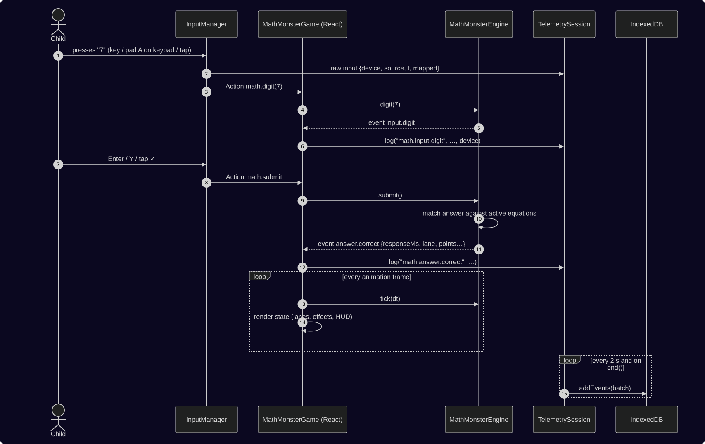

### 4. App navigation (state diagram)

*State (UML)* · source: [docs/ARCHITECTURE.md › 4. App navigation (state diagram)](ARCHITECTURE.md#4-app-navigation-state-diagram) · [open image](diagrams/architecture--4-app-navigation-state-diagram.svg)


### 5. Engine phases (Math Monster)

*State (UML)* · source: [docs/ARCHITECTURE.md › 5. Engine phases (Math Monster)](ARCHITECTURE.md#5-engine-phases-math-monster) · [open image](diagrams/architecture--5-engine-phases-math-monster.svg)


### 6. Storage: IndexedDB (ER diagram)

*Data (ER)* · source: [docs/ARCHITECTURE.md › 6. Storage: IndexedDB (ER diagram)](ARCHITECTURE.md#6-storage-indexeddb-er-diagram) · [open image](diagrams/architecture--6-storage-indexeddb-er-diagram.svg)


## Forge puzzles (order of operations)

From [docs/FORGE.md](FORGE.md).

### The board (pure state)

*State (UML)* · source: [docs/FORGE.md › The board (pure state)](FORGE.md#the-board-pure-state) · [open image](diagrams/forge--the-board-pure-state.svg)


## Mental math: how people actually calculate

From [docs/MENTAL-MATH.md](MENTAL-MATH.md).

### Model

*Class (UML)* · source: [docs/MENTAL-MATH.md › Model](MENTAL-MATH.md#model) · [open image](diagrams/mental-math--model.svg)


## Module: Math Monster (math-monster)

From [docs/modules/math-monster.md](modules/math-monster.md).

### Internal structure

*Class (UML)* · source: [docs/modules/math-monster.md › Internal structure](modules/math-monster.md#internal-structure) · [open image](diagrams/modules-math-monster--internal-structure.svg)


### Encounters, forms and spirits

*State (UML)* · source: [docs/modules/math-monster.md › Encounters, forms and spirits](modules/math-monster.md#encounters-forms-and-spirits) · [open image](diagrams/modules-math-monster--encounters-forms-and-spirits.svg)

### Practice mode (classroom)

*State (UML)* · source: [docs/modules/math-monster.md › Practice mode (classroom)](modules/math-monster.md#practice-mode-classroom) · [open image](diagrams/modules-math-monster--practice-mode-classroom.svg)


## Module: Maze Duel (maze-duel)

From [docs/modules/maze-duel.md](modules/maze-duel.md).

### Engine stages

*State (UML)* · source: [docs/modules/maze-duel.md › Engine stages](modules/maze-duel.md#engine-stages) · [open image](diagrams/modules-maze-duel--engine-stages.svg)

