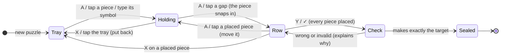

# Forge puzzles (order of operations)

**Make the target using every piece.** The pieces are numbers, signs and sometimes brackets; the puzzle is the *order*, because the order of operations decides what a row makes:

```
Target 20, pieces 2 3 4 + × ( )
  (2 + 3) × 4 = 20 ✓
   2 + 3 × 4  = 14 ✗   (× goes first)
```

Shared kit, used by Math Monster (Adventure boss rounds, Forge practice); any game can use it.

| Part | File |
|---|---|
| Expressions: parse, evaluate with steps and reasons, left-to-right evaluation, error messages | `src/core/math/expression.ts` |
| Puzzles: tiers, generator, traps, board state (pure functions), check | `src/core/math/forge.ts` |
| Thinking a puzzle through (companion / rival) | `src/core/mental-math/order.ts` (see MENTAL-MATH.md) |
| Board view and controls | `src/core/ui/forge/ForgeBoardView.tsx`, `controls.ts`, `forge.css`, `src/core/ui/useFlip.ts` |

## Order of operations (`evaluate`)

Brackets first, then × and ÷, then + and −, each left to right. Every calculation is recorded as a step with its reason (`brackets`, `times-first`, `left-to-right`); the board numbers each sign by when it is worked out. Rows that can't be calculated explain why: `empty`, `starts-with-op`, `ends-with-op`, `two-ops`, `two-numbers`, `bracket-open`, `bracket-close`, `empty-brackets`, `divide-by-zero`. A ÷ that doesn't come out even makes the row "not whole" (never right).

## Tiers

| Tier | Name | Pieces | Rules |
|---|---|---|---|
| 1 | Plus & minus | 3 numbers 1–9, + / − | target 2–25 |
| 2 | × before + | 3 numbers 2–9, one × with + or − | working left to right must give a different answer; target 4–90 |
| 3 | ÷ joins in | 3 numbers 2–9, a ÷ with + − or × | left to right must give a different answer; target 2–60 |
| 4 | Brackets | 3 numbers 2–9, × with + or −, ( ) | the brackets must change the answer; target 4–100 |
| 5 | Four numbers | 4 numbers 1–9, + − × ÷ (at least one × or ÷), no brackets | left to right must differ; target 2–100 |
| 6 | Master forger | 4 numbers 1–9, + − × ÷ and ( ) | the brackets must change the answer; target 2–100 |

(v0.12 had 4 tiers: 1, 2, brackets, four numbers with brackets half the time. Saved practice progress is mapped onto the new levels.)

Every puzzle: whole numbers, nothing negative along the way, solvable by construction, and **the order must matter** (at least two different results across all arrangements). From tier 2 the generator prefers puzzles with a **trap**: an arrangement that makes the target when read left to right with no rules, but not with the real order (`trapsFor`). That is the mistake to learn from, and the companion's `left-to-right` slip uses it. The tray shows numbers (small → big), then signs, then brackets, so it never gives the answer away.

## The board (pure state)

`ForgeBoard = { puzzle, row, held, heldFrom, cursor }`. The cursor is in the **tray** or the **row**; in the row it points at a *gap* while a piece is held, otherwise at a piece.



| Function | Does |
|---|---|
| `forgePrimary` (A) | pick up the piece at the cursor (cursor jumps to the end of the row) / place the held piece at the cursor gap (cursor goes back to the tray) |
| `forgeSecondary` (X) | put the held piece back where it came from / send the row piece at the cursor back to the tray |
| `forgeNav` | move the cursor; up = row, down = tray |
| `forgeTake`, `forgeDrop`, `forgeStash`, `forgeReturn` | direct versions for touch |
| `forgeQuick(symbol)` | keyboard: grab the tray piece showing `7`, `+`, `*`, `/`, `x`, `(`… |
| `forgeCheck` (Y) | `incomplete` (pieces left) · `invalid` (with the error and where) · `wrong` (with the value and steps) · `right` |
| `forgePreview` | the row's value and steps so far (live) |

## Controls

| Device | Move | Pick up / place | Put back | Check |
|---|---|---|---|---|
| Controller | stick / D-pad | A | X (or B) | Y (or RT) |
| Keyboard | arrows | Enter, or type the piece's symbol to grab it | Backspace | Space or = |
| Touch / mouse | – | tap a piece, then tap where it goes (before the piece you tap, or the empty end) | tap the tray while holding | ✓ button |

The held piece rides along the row at the cursor, so the others slide apart to make room (FLIP via `useFlip`: positions are layout offsets, safe to run every frame).

## Where it is used

- **Adventure boss rounds** (Math Monster engine `forge` option): 3 seals break the shard, the spirit's attack charges meanwhile (a full charge costs a life; the puzzle stays). The time left is shown inside the row as a countdown (`ForgeBoardView` `timer`). Tier = `ceil(level / 5)`, max 6. See docs/modules/math-monster.md.
- **Forge workshop** (practice): its own ladder of levels 1–6. A lesson = 8 puzzles at one level, no timer (a stopwatch shows time spent). **Clean** = sealed within 2 tries and without a hint; 6 clean passes and unlocks the next level. Alone, or with the companion forging alongside. See docs/modules/math-monster.md.

Telemetry: `math.forge.*` in TELEMETRY.md.
