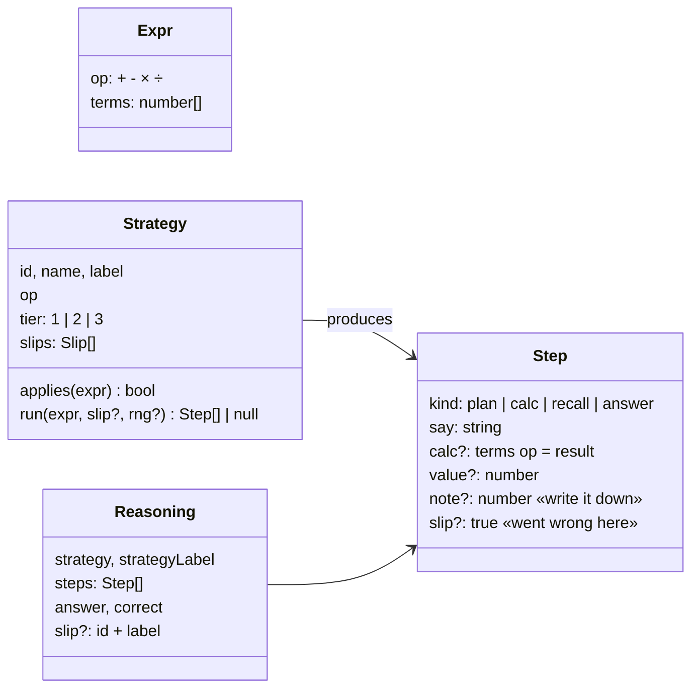

# Mental math: how people actually calculate

`src/core/mental-math/` is a **core module** that models how a child (and later an adult) works a sum out in their head. It isn't just "the answer is 13". It produces the *reasoning*, using real strategies taught in primary maths:

```
3 + 2       → "3 + 2 = 3 + 1 + 1", "3 + 1 = 4", "4 + 1 = 5"        (count on)
3 + 6 + 4   → "3 + 6 = 9" 📝, "9 + 4 = 13"                        (one at a time)
            → "Look for a 10: 6 + 4", "6 + 4 = 10" 📝, "10 + 3 = 13"   (find a 10)
```

The same model produces **mistakes**. A wrong answer is never a random number: it comes from a typical *slip inside the reasoning*, and the step where it went wrong is marked:

```
3 + 6 + 4   → "Look for a 10: 6 + 4", "6 + 4 = 10", "So it's 10" ✗    Oops: I forgot to add the 3
64 − 27     → "60 − 20 = 40", "7 − 4 = 3" ✗, "40 + 3 = 43"            Oops: I did 7 − 4 instead of 4 − 7
47 + 38     → … "70 + 5 = 75" ✗                                        Oops: I forgot the ten inside 15
```

It is used today by the companion in the practice classroom (its thought bubble). It's in `core/` because other games, hint systems and the planned MCP/worksheet tooling can use it too (e.g. "explain how to do 8 + 5", or "which strategy did this child's mistake come from?").

## Model



- **`think(expr, { proficiency, wrong, rng })`** picks a strategy and returns a `Reasoning`.
  - *Proficiency* (0–1) sets the preferred **tier**: beginners (tier 1) count on, count back, add again or skip-count. Middle learners (tier 2) use known facts, make ten, doubles and jumps. Fluent thinkers (tier 3) group to ten, split into tens and ones, use columns, derived facts and recall. Choice is weighted, so some variety remains.
  - *wrong: true* returns reasoning containing one of that strategy's slips (falling back to other strategies, and finally `stepwise`). The answer is always a whole number ≥ 0 and never accidentally correct.
- **`strategiesFor(expr)`** lists every strategy that applies, each with correct steps. Useful for hints and "show me another way".
- **Notes (`step.note`):** values worth writing down to come back to (the 70 and 15 in 70 + 15). The classroom shows them on the companion's notepad. This is the basis for the planned **thought-bubble + note system**, where a problem is worked in parts, each part written down before the next thought.
- **Steps are verifiable:** every unmarked `calc` step is true arithmetic, and the final value follows from the steps. The tests check this for every strategy and every slip over about 2,800 generated problems.

## Strategy catalogue

Tier: 1 = counting-based · 2 = fact-based · 3 = fluent. 📝 = written down as a note.

### Addition
| Strategy (label) | Tier | When | Example | Typical slips |
|---|---|---|---|---|
| Counting on (*Count on*) | 1 | one number ≤ 4 | 3 + 2 = 3 + 1 + 1 → 4 → 5 | counted the start number ("3 + 1 = 3"); counted one too many |
| Adding in order (*One at a time*) | 1 | 3+ numbers | 3 + 6 = 9 📝, 9 + 4 = 13 | a slip on the way (±1 in one step, carried forward) |
| Doubles / near doubles (*Doubles*) | 2 | numbers equal or 1 apart | 6 + 6 = 12 📝, 12 + 1 = 13 | wrong double; went down instead of up |
| Bridging through ten (*Make 10*) | 2 | single digits, total > 10 | 8 needs 2 → 5 = 2 + 3 → 8 + 2 = 10 📝 → 10 + 3 = 13 | wrong complement ("8 needs 3"); added the last bit wrong |
| Number-line jumps (*Jumps*) | 2 | one number ≥ 10 | 47 + 30 = 77 📝, 77 + 3 = 80 📝, 80 + 5 = 85 | jumped the wrong amount |
| Grouping to ten (*Find a 10*) | 3 | 3+ numbers with a pair making 10 | Look for a 10: 6 + 4 = 10 📝, 10 + 3 = 13 | **forgot the remaining number**; added the pair wrong |
| Partitioning (*Tens and ones*) | 3 | both two-digit | 40 + 30 = 70 📝, 7 + 8 = 15 📝, 70 + 15 = 85 | **dropped the ten** (70 + 5 = 75); tens wrong |
| Known fact (*I know it*) | 3 | both ≤ 10 | I know 3 + 4 = 7 | remembered it wrong |
| Adding zero (*Plus 0*) | 2 | + 0 | Adding 0 changes nothing | "adding 0 adds one more" |

### Subtraction
| Strategy (label) | Tier | When | Example | Typical slips |
|---|---|---|---|---|
| Counting back (*Count back*) | 1 | take away ≤ 4 | 9 − 1 = 8, 8 − 1 = 7 | counted the start number; one too many |
| Counting up (*Count up*) | 2 | difference ≤ 20 | 8 + ? = 13 → 8 + 2 = 10 📝 → 10 + 3 = 13 📝 → 2 + 3 = 5 | **only counted from 10** (answers 3); counted up to 10 wrong |
| Bridging back (*Back to 10*) | 2 | crosses a ten | 5 = 3 + 2 → 13 − 3 = 10 📝 → 10 − 2 = 8 | split the number wrong |
| Ones within a ten (*Just the ones*) | 2 | no crossing | 5 − 5 = 0 📝 → 90 + 0 = 90 | ones wrong |
| From a whole ten (*Break a ten*) | 2 | 70 − 6 | 70 = 60 + 10 → 10 − 6 = 4 📝 → 60 + 4 = 64 | **kept the ten** (70 + 4 = 74) |
| Jumping back (*Jump back*) | 2 | take away ≥ 10 | 64 − 20 = 44 📝 → 44 − 7 = 37 | forgot the ones (44); added the ones |
| Columns with exchange (*Columns*) | 3 | both two-digit | swap a ten: 50 − 20 = 30 📝, 14 − 7 = 7 📝 → 37 | **smaller-from-larger** (7 − 4 = 3 → 43) |
| Known fact / minus zero | 2–3 | small facts / − 0 | I know 9 − 4 = 5 | remembered wrong; "minus 0 makes 0" |

### Multiplication
| Strategy (label) | Tier | When | Example | Typical slips |
|---|---|---|---|---|
| Repeated addition (*Add again*) | 1 | a factor 2–4 | 4 + 4 = 8 📝, 8 + 4 = 12 | added one group too many |
| Counting in steps (*Count in 5s*) | 1 | a factor 2, 5 or 10 | 5, 10, 15 → 15 | one jump too many |
| Doubling (*Double it*) | 2 | a factor 4 or 8 | 2 × 7 = 14 📝, double 14 = 28 | doubling slip (double 14 = 18, a dropped ten) |
| Derived from ×10 (*Use ×10*) | 3 | a factor 9 or 5 | 10 × 7 = 70 📝, 70 − 7 = 63 · half of 80 = 40 | took away 9 instead of 7; halved wrong |
| Splitting a factor (*Split it*) | 3 | a factor > 10 | 10 × 6 = 60 📝, 2 × 6 = 12 📝, 60 + 12 = 72 | forgot the second part |
| Known fact (*I know it*) | 3 | table facts | I know 7 × 8 = 56 | neighbour fact (7 × 7) |
| ×1 and ×0 | 2 | × 0 or × 1 | anything × 0 is 0 | "×0 leaves it the same"; "×1 makes 1" |

### Division
| Strategy (label) | Tier | When | Example | Typical slips |
|---|---|---|---|---|
| Counting jumps (*Count jumps*) | 1 | quotient ≤ 6 | 5, 10, 15 → 3 jumps | counted the 0 as a jump |
| Inverse multiplication (*Times backwards*) | 2 | table range | 8 × ? = 56 → 8 × 7 = 56 → 7 | used the wrong times fact |
| Dividing by 1 | 2 | ÷ 1 | shared into 1 group | "÷1 makes 1" |

`stepwise` (work it out in order) is the fallback when nothing else applies.

## How the companion uses it

`modules/math-monster/companion.ts`:
1. The calibrated skill model decides *whether* this attempt is right (`correctChance(difficulty, mastery)`). That's unchanged, so mastery 5 is still perfect at normal speed.
2. `think()` produces the reasoning at proficiency = mastery / 5, correct or with a slip.
3. Think time scales with the number of steps (`0.75 + 0.08 × steps`), so fluent strategies are also faster.

In the classroom the companion works **one equation at a time**. Its bubble reveals the steps as it thinks, then shows the answer (✓/✗). On a wrong answer, the slip step is highlighted and it says what went wrong. Notes appear on its notepad.

## Adding a strategy

1. Write it in the right file (`addition.ts`, `subtraction.ts`, `multiplication.ts` or `special.ts`): `applies`, `run(e, slip?)` and its `slips`. Use the helpers `calc`, `recall`, `plan` and `answer` from `steps.ts`, and mark notes and slip steps.
2. Every `calc` step that isn't a slip **must be true**, and slips must return `null` where they can't happen.
3. Add it to the file's export list. The property tests in `mental-math.test.ts` will check it automatically. Add an example test for the canonical case.
4. Add a row to the catalogue above, and a patch note.
