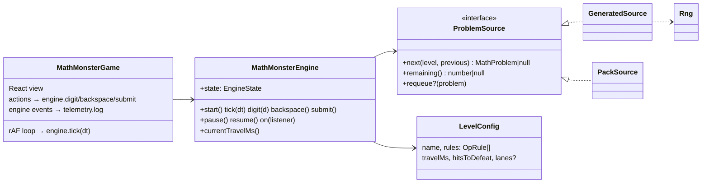
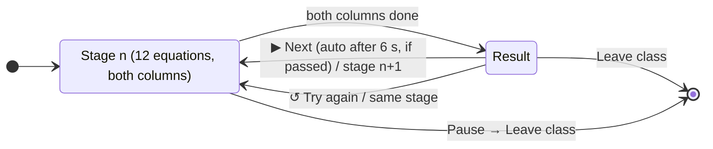

# Module: Math Monster (`math-monster`)

Mental arithmetic as an anime battle. Corrupted **spirits** hurl equations at the hero, and the child types the answer before they land. Each spirit is fought over a 5-round **encounter**: every round it takes a less menacing, cuter form. In the final boss round its last Static shard breaks, the spirit is **purified**, and it can be **befriended** as a companion. Lore: [docs/lore/WORLD.md](../lore/WORLD.md).

## Files

| File | Role |
|---|---|
| `index.ts` | `GameModule` definition: presets, settings, `importPack` |
| `engine.ts` | **Pure game rules.** Lanes, spawning, answers, scoring, lives, levels, encounters/rounds/boss, events |
| `levels.ts` | Default difficulty curve (10 stages) + `levelAt()` endless extension |
| `problems.ts` | `ProblemSource` implementations: `GeneratedSource` (random by rules), `PackSource` (fixed worksheet) |
| `schema.ts` | zod schemas: `OpRule`, `LevelConfig`, `MathPack`; `parseMathPack`, `solve`, `makeProblem` |
| `rng.ts` | Seeded PRNG (mulberry32). The engine never uses `Math.random` |
| `summary.ts` | Session summary for results and storage (see TELEMETRY.md) |
| `controls.ts` | `MathAction` + `mathControls` scheme |
| `keypadLayout.ts` | Keypad keys, cursor movement, action ↔ key lookup |
| `MathMonsterGame.tsx` | Module entry: picks the mode component |
| `options.ts` | `MathOptions` (adventure · pack · practice), `createEngine`, `normalTravelMs` |
| `useMathSession.ts` | Shared hook for all modes: frame loop, input → engine, keypad state, telemetry wiring, finish |
| `AdventureGame.tsx` | Adventure view: battlefield, encounters, transformations, befriend |
| `PracticeGame.tsx` + `practice.css` | Practice: stage flow (`PracticeGame`), one lesson with two columns/engines (`ClassroomStage`), result panel (`StageEnd`) |
| `classroom.ts` | Classroom stage ladder: topic/pace/lanes/speed per stage, pass threshold |
| `companion.ts` | **Companion skill model** (pure): difficulty, think time, accuracy; reasoning (right or with a slip) comes from `core/mental-math` |
| `MathHub.tsx` | Module `Hub`: practice classroom section + Spirit Journal; owns spirit progress loading |
| `Dock.tsx`, `PauseMenu.tsx` | Shared answer box/keypad dock and pause menu |
| `creatures.ts` | **Spirit data**: names, 5 forms (title + banner line), colours, personality, story. The lore source of truth |
| `spirits.ts` | Per-player spirit progress (met / best form / purified / companion): pure functions + load/save via core `progress` store |
| `Creature.tsx` | Procedural creature art: one `form` (0–4) drives every feature from menacing to cute; `shard` = boss crown |
| `Befriend.tsx` | Post-boss story dialog: befriend / not now |
| `SpiritJournal.tsx` | Journal (presentational): collection, stories, maths stars, companion choice |
| `Keypad.tsx`, `Art.tsx` | Presentational: keypad, SVG hero |
| `mathMonster.css` | All module styles (`mm-` prefix) |
| `__tests__/engine.test.ts` | Engine, generator, encounter/boss, pack tests |
| `__tests__/spirits.test.ts` | Roster shape, colour interpolation, progress rules |

## Internal structure

## Encounters, forms and spirits

```mermaid
stateDiagram-v2
  direction LR
  [*] --> R1
  R1: Round 1 · form 0 Corrupted
  R2: Round 2 · form 1 Cracking
  R3: Round 3 · form 2 Wavering
  R4: Round 4 · form 3 Softened
  R5: Round 5 · BOSS · form 4 + shard (1.5× HP, +1 lane)
  R1 --> R2: K.O. → transform
  R2 --> R3: K.O. → transform
  R3 --> R4: K.O. → transform
  R4 --> R5: K.O. → transform
  R5 --> Purified: shard breaks
  Purified --> Befriend: dialog (game paused, reason "story")
  Befriend --> [*]: next spirit's encounter
```

- **Engine** (`engine.ts`) knows only `encounter` / `round` / `boss`, counted from the session's start level (`roundsPerEncounter`, default 5). It applies the boss modifiers. It knows nothing about which creature is shown.
- **View** (`AdventureGame.tsx`) maps `encounter` → creature using `encounterOrder(progress)`: unpurified spirits first, then rematches. `round − 1` is the form.
- Because the engine schedules the next round at K.O. time, the view keeps the *defeated* form on stage for the K.O. (0.8 s) and then flashes in the new form. For a boss, it keeps the purified spirit on stage until the befriend dialog.
- An encounter is recorded (`math.spirit.encounter`, `recordForm`) on the **first equation** of each round, not at `level.start`.
- **Difficulty is independent of creatures.** Stage content still follows `DEFAULT_LEVELS` by level number. Encounters are just layered on top in groups of 5.
- **Progress** (`spirits.ts`, stored in the core `progress` store under `math-monster:<profileId>`): `{ version: 1, spirits: { [id]: { encountered, bestForm, purifiedAt? } }, companion }`. Only purified spirits can be companions.

## Practice mode (classroom)

Unlocked once a spirit is befriended (the current companion joins you). Started from the hub with `{ mode: 'practice', stage, companionId }`.

- **Two columns, two engines:** `ClassroomStage` runs the player's engine (driven by input via `useMathSession`) and a separate **companion engine** with its own equations (same stage, different seed). The companion engine is ticked in the player's frame loop (`onFrame(dt)`), so both pause together.
- **Companion bot:** works on **one equation at a time**: the most urgent untried one in its column (marked 💭). It plans an attempt with `companion.attempt` (seeded), which includes its **reasoning** from `core/mental-math` (see [MENTAL-MATH.md](../MENTAL-MATH.md)). The thought bubble (`ThinkBubble`) shows the problem, strategy label, steps revealed over the think time, and then the answer. When its time is up it answers with `engine.answerFor(id, answer)`: right → ✨; wrong → 😢, the slip step highlighted with its "Oops: …" label, and the equation crossed out and drifting on. If the equation lands first → 😅. After answering it rests (1.3 s right / 2.6 s wrong / 1.7 s unsure) so the bubble can be read. Equations it never reached count as out of time. Steps with `note` go on the desk notepad. It never waits for the player.
- **Stage setup** (`createEngine` + `classroom.stageConfig`): one fixed topic level (no level-ups or bosses), `LimitedSource` of 12, `unlimitedLives`, `speedUp: 1`, `wrongPenalty: 0.05`, lanes from the stage (1 calm / 2 quick), and speed = setting × stage `speedFactor` (1, 1.3 quick, ×1.1 per stage past 16).
- **Stage ladder** (`classroom.ts`): stage → topic `TOPIC_LADDER[⌊(stage−1)/2⌋]`: small sums, sums to 10, **three numbers: find a 10** (classroom-only config: 3 terms, one pair always makes 10), take away, ± to 20, 2/5/10 tables, times tables, big sums, sharing. Odd stages are calm, even stages quick. Pass = `PASS_CORRECT` (9 of 12) player-correct answers.
- **End of stage** (both engines `complete`): `recordPractice` (+1 companion mastery, max 5) and `recordStage` (passing unlocks stage n+1) are saved, `math.practice.stage.end` is logged, and the result panel offers Next (auto-advance countdown when passed), Try again and Leave. Each retry or next stage remounts `ClassroomStage` with a fresh seed. The telemetry session spans the whole visit.
- **Session result** (on leave): merges all stages (`summarize` accepts merged stats) and adds `summary.practice` with per-stage results.

### Companion skill model (`companion.ts`)

| | Formula |
|---|---|
| difficulty `d` (0–1) | `+`: 0.08 + 0.45·min(ans,100)/100 (+0.15 with carry) · `−`: 0.12 + 0.45·a/100 (+0.15 with borrow) · `×`: 0.3 + 0.5·ans/100 · `÷`: 0.4 + 0.5·a/100 |
| skill `s` | mastery / 5 |
| think time | `(0.3 + 0.95·d) · (1 − 0.55·s) · normalTravelMs · jitter(0.85–1.15)` |
| finished? | think time < this equation's actual travel time (so Turbo can outpace it) |
| P(correct) | 1 at s = 1, else `max(0.15, 1 − 0.9·d·(1 − s))` |
| reasoning & mistakes | `think({op, terms}, { proficiency: s, wrong: !right })`: strategy tier by proficiency; wrong answers come from a slip in the reasoning (see MENTAL-MATH.md) |
| step factor | think time × `(0.75 + 0.08 × steps)` |

`normalTravelMs` = level travel time × lane bonus for Auto lanes at speed 1 (the "normal auto speed" yardstick). Tests check that 5★ gets 100% on every topic, that each star helps, and that 0★ struggles with ÷.

## Rules (as implemented in `engine.ts`)

- **Lanes:** up to `lanes` equations fly at once (1–4), one per lane. `lanes` comes from the setting, or from the level when the setting is `auto`. Spawns are staggered by `max(600, travelMs / lanes × 0.55)` ms. The engine never has more in flight than the spirit has HP left, so a round ends cleanly.
- **Answer matching:** a submitted number hits the equation it solves. If several match, the one with the highest `progress` (most dangerous) is hit.
- **Wrong answer:** the front equation jumps forward by `wrongPenalty` (0.12, capped at 0.98) and the streak resets.
- **Timeout** (progress reaches 1): lose a life, streak resets. In pack mode the problem is re-queued. At 0 lives the game is over.
- **Travel time:** `level.travelMs × speedUp^hitsThisLevel × (1 + 0.35 × (lanes − 1)) ÷ speedMultiplier`, with a floor of 1200 ms. `speedUp` defaults to 0.95; packs can set their own.
- **Points:** `(10 + 2·level + round(20·(1 − progress)) + 5·(concurrent − 1)) × (1 + 0.1·min(streak − 1, 10))`.
- **Effects:** "CRITICAL!" when answered at `progress < 0.35`. The view derives every animation from `state.effects` (the last 12 outcomes), so the engine stays UI-free.
- **Boss rounds** (last round of each encounter): `hitsToDefeat × 1.5` (rounded up), one extra lane (max 4) when lanes are on Auto, and a 3.2 s post-defeat pause instead of 1.8 s.
- **Levels:** see the table below. Past stage 10, `levelAt()` repeats the last rules, is 12% faster per stage (floor 2000 ms) and adds a lane every 3 stages (max 4).

| Stage | Name | Content | travelMs | Hits | Lanes (auto) |
|---|---|---|---|---|---|
| 1 | Small sums | a+b, 0–5 | 14000 | 5 | 1 |
| 2 | Sums to 10 | a+b ≤ 10 | 12500 | 6 | 1 |
| 3 | Take away | a−b within 10 | 12500 | 6 | 2 |
| 4 | Mix to 10 | ± within 10 | 11000 | 8 | 2 |
| 5 | Sums to 20 | ± within 20 | 11000 | 8 | 2 |
| 6 | 2, 5 and 10 tables | × | 10000 | 8 | 2 |
| 7 | Times tables | × 2–10 | 10000 | 10 | 2 |
| 8 | Big sums | ± to 100 | 13000 | 8 | 2 |
| 9 | Sharing | ÷ (exact) | 10000 | 10 | 2 |
| 10 | Lightning round | mixed, × weighted | 8000 | 12 | 3 |

## Settings (per player)

| id | Choices | Effect |
|---|---|---|
| `speed` | 0.7 Chill · 1 Normal · 1.4 Fast · 2 Turbo · 3 Insane | `speedMultiplier` |
| `lanes` | auto · 1 · 2 · 3 · 4 | max equations at once |

## Controls

| Device | Mapping |
|---|---|
| Keyboard | 0–9 type · Enter/Space fire · Backspace/Delete erase · Esc/P pause. The on-screen keypad hides while a keyboard is in use |
| Gamepad | D-pad/left stick moves the keypad cursor · A presses · B/X erase · Y/RT fire · Start pause |
| Touch/mouse | on-screen keypad in the bottom-left dock (a bottom bar on portrait phones) |

## Content packs

Packs follow `MathPackSchema`; see `docs/examples/math-worksheet.json`. Fields: `id`, `title`, `description?`, `problems[{a, op, b, answer?}]`, `order` (`shuffle`·`sequence`), `travelMs`, `speedUp`, `lanes`. Validation rejects non-exact division, negative results and a given `answer` that is wrong. A pack is split into rounds of 6 hits each, which follow the same encounter structure (5 rounds, boss last).

## Extending

- **New stage:** append to `DEFAULT_LEVELS`. Tests check every rule generates valid, non-negative integer answers.
- **New operation** (e.g. missing number `3 + ? = 7`): extend `OpSchema`, `solve`, `generate` and `MathProblem.text`, and add tests. Telemetry `key`s must stay unique per fact.
- **Adaptive difficulty** (planned): read the `hardestFacts` and `byOp` history for the profile and weight `GeneratedSource` toward weak facts.
