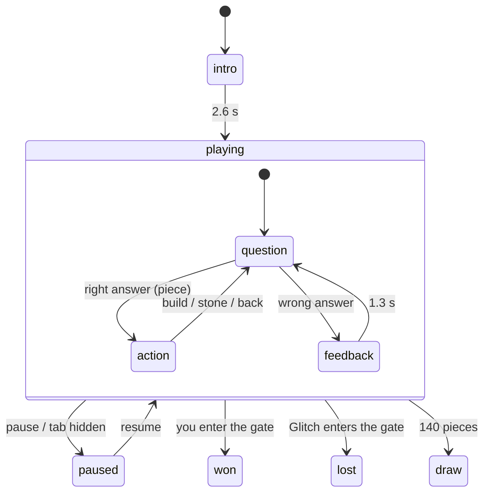

# Module: Maze Duel (`maze-duel`)

A maths race against an opponent. You and **Glitch** (a cheeky Static imp) each build a path through a number maze to the ★ Star Gate. Right answers earn the pieces, and the maze itself is arithmetic: the number your path carries changes on operator squares, and only *exactly* the gate's number opens it. Two kinds of maths at once: fast facts (the equations) and planning (which squares make the target).

## Rules

- **Board:** 9 × 7. You start at the left middle, Glitch at the right middle, the gate is in the centre. The two halves are mirror images, separated by a crystal wall that only opens at the gate (so both sides have the same routes).
- **Your number** starts at **1**. Stepping on a square applies it: `+n`, `−n`, `×n`, `÷n` (open squares change nothing). ÷ must divide evenly, and numbers stay within 0–99; moves that break this aren't offered.
- **The gate** can only be entered when your number equals the target. First one in wins.
- **Equations:** you get one equation at a time (topic from the preset). A right answer earns a **piece**; a wrong one shows the right answer for 1.3 s and earns nothing. There is no timer: speed matters because Glitch keeps going.
- **A piece** is spent on one of:
  - **Build:** one square next to your path's end (not onto a rock, a stone or a path).
  - **Stone** (3 per duel): on an empty or operator square next to **Glitch's** path end. A stone may not leave a side with no route at all from its start, and never goes on or next to the gate.
  - **Back:** take your last square back.
- **Draw** after 140 pieces in total (rare; it needs both sides to stall).

## Glitch (`ai.ts`)

- **Maths:** for each equation it calls `core/mental-math` `think()` with its skill as proficiency. Wrong answers are slips in that reasoning, and the bubble shows the steps as it thinks (the answer appears at the end). Accuracy = `max(0.3, 1 − difficulty × (1 − skill) × 0.8)`. Think time = `(1.8 s + 5.2 s × difficulty) × (1.45 − 0.75 × skill) × jitter × steps factor` + **your input-pace allowance**.
- **Planning** (when it has a piece): win if it can step into the gate; otherwise, if you're within *blockWhen* squares of winning and not behind it, drop a stone on your next square; otherwise follow its shortest route to the target (sometimes wandering onto another workable square); at a dead end, step back and remember that move as dead (forgotten when a square is freed).

| Difficulty | Skill | Wanders | Blocks when you're within | Block chance |
|---|---|---|---|---|
| Easy (default) | 0.15 | 30 % | 2 squares | 50 % |
| Medium | 0.5 | 12 % | 3 squares | 80 % |
| Hard | 0.85 | 0 % | 4 squares | 100 % |

## Board generation (`board.ts`)

Seeded (`generateBoard(seed)`): the left half gets about 20 % rocks and 32 % operator squares (+1…+5, −1…−3, ×2/×3, ÷2/÷3), the middle column is wall except the gate, and the right half mirrors the left. The target is chosen among the numbers reachable at the gate (4–40) that need 5–10 squares and **can't** be made without operator squares. Up to 200 attempts per seed. `findRoute` (iterative-deepening DFS with a distance bound and a work cap) answers "shortest route that hits the target" for the rival, the hints and the no-sealing rule.

## Controls

| | Answering | Placing a piece |
|---|---|---|
| Keyboard | 0–9, Backspace, Enter | arrows/WASD aim at a square next to the path end, Enter places, Tab/M build ↔ stone, Backspace steps back |
| Controller | radial dial: stick points, A types, X deletes, Y sends | stick/D-pad aim, A (or Y) places, X build ↔ stone, B steps back |
| Touch / mouse | on-screen keypad | tap a glowing square; buttons for Build / Stone / Back |

The two stages use two control schemes (`answerControls`, `pieceControls`). The view switches them from the engine's stage every frame and after every action, not from React renders. Start/Esc pauses.

## Files

| File | Role |
|---|---|
| `index.ts` | `GameModule`: presets (topics), settings (rival, hints, input help), hub |
| `board.ts` | **Pure:** board model, operator rules (`applyCell`), generator, `findRoute` |
| `duel.ts` | **Pure `DuelEngine`:** phases, your question/piece stages, the rival's think → reveal → act loop, legal moves, events |
| `ai.ts` | Glitch: difficulty levels, maths (`solve`), planner (`plan` with dead-end memory) |
| `topics.ts` | Presets → level rules from `core/math/levels` |
| `controls.ts` | `answerControls` and `pieceControls` |
| `DuelGame.tsx` | View: frame loop, input → engine, scheme switching, telemetry, sounds, banners, pause |
| `BoardView.tsx` | The maze grid (paths, values, previews, hints, cursor, effects) |
| `Glitch.tsx` | Glitch's SVG art and moods |
| `DuelHub.tsx` | Module screen panel: Glitch, rules, your record |
| `summary.ts`, `progress.ts` | Session summary + results highlights; per-player win/loss record |
| `duel.css` | Module styles (`dd-` prefix) |
| `__tests__/duel.test.ts` | Board fairness/solvability, operator rules, engine flow, no-sealing property, stones, step back, determinism, rival behaviour, AI-against-AI completion |

## Engine stages

Glitch runs its own loop in parallel: **thinking** (its think time) → **reveal** (0.9 s, longer when wrong) → **acting** (0.7 s, decides then plays) → **rest** → next equation.

Telemetry events and the summary are listed in [TELEMETRY.md](../TELEMETRY.md#maze-duel-duel).
